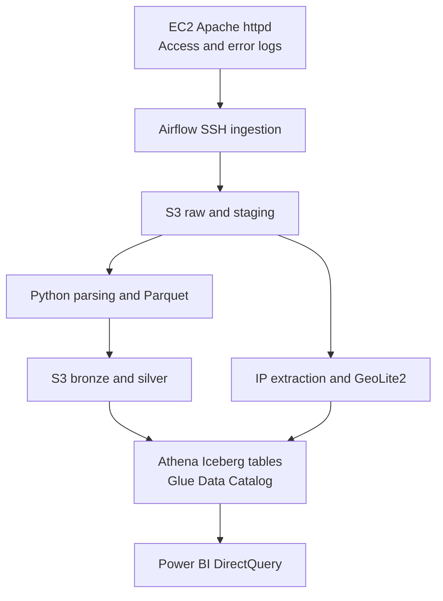

# EC2 Apache Log Analytics Pipeline to Power BI

An end-to-end data engineering project that collects Apache HTTP Server logs from an Amazon EC2 instance, processes and enriches the data using Apache Airflow and Python, stores datasets in Amazon S3, queries Apache Iceberg tables through Amazon Athena, and visualizes website activity in Microsoft Power BI.

**Author:** Abdullah Alamoodi  
**Stack:** AWS EC2 · Apache httpd · Apache Airflow · Docker · Python · Amazon S3 · Parquet · AWS Glue Data Catalog · Amazon Athena · Apache Iceberg · GeoLite2 · Power BI

> **Project status:** This README reflects the implementation details captured during development in 2026. Some deployment-specific settings and dashboard details still need to be verified against the current codebase. Recommendations are marked separately from implemented components.

## Project objectives

- Transform raw web server access and error logs into structured, queryable datasets.
- Automate ingestion, transformation, enrichment, and data-quality checks.
- Analyze traffic patterns, failed requests, client geography, and recurring server issues.
- Balance data freshness with storage and query costs.
- Serve interactive Power BI reports using Athena DirectQuery.

## Architecture



### Main components

| Component | Purpose |
| --- | --- |
| EC2 / Apache httpd | Generates HTTP access and server error logs. |
| Apache Airflow 3.3.1 | Orchestrates scheduled tasks, retries, and validation. |
| Docker, CeleryExecutor, Redis, PostgreSQL | Hosts the distributed Airflow deployment and its supporting services. |
| Amazon S3 | Stores date-partitioned raw files and Parquet datasets. |
| Python and GeoLite2 City | Parses logs and adds approximate IP geolocation. |
| AWS Glue Data Catalog | Registers metadata for Athena tables. |
| Amazon Athena / Apache Iceberg | Provides SQL querying and managed analytical tables. |
| Microsoft Power BI | Builds DirectQuery dashboards and KPI reporting. |

## Data sources and schemas

The source is Apache httpd running on EC2. The ingestion workflow collects both `access_log` and `error_log` over SSH.

### Access logs

The parser extracts the following fields from supported access log records:

| Field | Description |
| --- | --- |
| `ip` | Client IP address. |
| `timestamp` | Request timestamp, interpreted with explicit timezone handling. |
| `method` | HTTP method such as GET or POST. |
| `path` | Requested URL path. |
| `protocol` | HTTP protocol version. |
| `status_code` | HTTP response status code. |
| `response_size` | Response size reported by the server. |

### Error logs

The error parser extracts `timestamp`, `module`, `pid`, and `message` where present in the Apache error-log format.

**Timezone:** Reporting uses `Asia/Riyadh`. Timestamps should be normalized consistently before deriving dates, weekdays, and hourly traffic statistics.

## Pipeline workflow

### 1. Ingest EC2 logs into S3

The ingestion DAG checks the SSH connection, transfers the active access and error log files to date-based S3 prefixes, and verifies uploaded objects. The collection schedule evolved from a daily job to an approximately **15-minute ingestion cadence**.

Conceptual storage layout (actual bucket and prefix names depend on deployment):

```text
s3://<bucket>/
├── raw/YYYY/MM/DD/
├── staging/YYYY/MM/DD/
├── bronze/YYYY/MM/DD/
└── silver/YYYY/MM/DD/
```

> **Operational consideration:** Re-uploading an entire active log every 15 minutes does not inherently provide incremental ingestion. Offset tracking, rotated-file identifiers, or downstream deduplication are needed to avoid counting the same request more than once.

### 2. Parse and transform

Python tasks parse raw log lines, validate important fields, and write columnar Parquet datasets. The bronze layer preserves structured source records; the silver layer prepares records for analytical querying.

Representative tables in the `stedi` Athena database:

| Table | Purpose |
| --- | --- |
| `bronze_access_log` | Parsed access-log records. |
| `bronze_error_log` | Parsed error-log records. |
| `access_log` | Curated HTTP request records. |
| `error_log` | Curated Apache error records. |
| `all_ips` | IP occurrences extracted from source records. |
| `location_ips` | Distinct IPs with GeoLite2 location attributes. |
| `location_ip` | Joined IP and location context. |

### 3. Enrich IP addresses

The IP pipeline creates `distinct_ips` and `all_ips` Parquet outputs, resolves distinct addresses against a local GeoLite2 City database, and publishes location datasets. Enrichment fields include country, region, city, latitude, longitude, and timezone when available.

Geolocation is approximate; a resolved city or coordinate is not a precise location of an individual user. Missing or private IPs should be handled explicitly.

### 4. Load and query Athena Iceberg tables

AWS Glue Data Catalog contains the metadata Athena uses to query the curated tables. Existing development included `INSERT INTO ... SELECT` loading patterns and AthenaHook-based row-count validation. `MERGE`/UPSERT strategies were explored as an improvement, but should not be assumed deployed without checking the DAGs.

Example validation SQL:

```sql
SELECT COUNT(*) AS request_count
FROM stedi.access_log;

SELECT status_code, COUNT(*) AS requests
FROM stedi.access_log
GROUP BY status_code
ORDER BY requests DESC;
```

For robust reruns, use idempotent loads and a validated record identity. `(ip, timestamp, method, path)` was considered as a possible deduplication key, but can collide for legitimate requests and requires testing against the actual log format.

### 5. Connect Power BI to Athena

Power BI uses **DirectQuery** to request query results from Athena. This supports reports without importing all log records into the Power BI model, while introducing Athena query latency and per-query scan costs.

Suggested report pages:

| Report page | Metrics and visuals |
| --- | --- |
| Traffic Overview | Total requests, daily trend, visits by hour and weekday, HTTP methods. |
| HTTP Errors | 4xx and 5xx rate, most frequent 404 paths, server-error spikes. |
| Clients and Geography | Top IPs, traffic by country, location map, country-level error rate. |
| Content and Usage | Most requested pages, response sizes, referrers if recorded. |
| Traffic Classification | Bot flag, Human/Scanner labeling, network type if classification rules are implemented. |

Example analytical definitions:

```text
HTTP Error Rate   = Requests with status_code >= 400 / All requests
Server Error Rate = Requests with status_code >= 500 / All requests
Country Error Rate = Error requests from country / All requests from country
```

Define whether an error KPI includes 4xx, 5xx, or both. Protect against division by zero and make geographic joins one-to-one at the appropriate granularity to prevent inflated request counts.

## Development observations

These are **separate development snapshots**, not one reconciled reporting period:

| Observation | Value |
| --- | ---: |
| Access records in an October 2026 staging snapshot | 26,267 |
| Error records in that staging review | 62 |
| Distinct IP addresses in the enrichment snapshot | 1,006 |
| IP occurrence rows in the enrichment snapshot | 16,109 |
| Typical new logs per day (approximation) | 3,000 |
| Ingestion cadence | About every 15 minutes |

## Data quality

The pipeline has used AthenaHook queries to verify loaded row counts. Recommended additional checks include:

1. Verify files were uploaded to the expected dated prefix.
2. Track total lines read, parsed lines, rejected lines, and parsing success rate.
3. Validate critical fields (`timestamp`, `ip`, `method`, `status_code`).
4. Check status-code ranges and null/invalid timestamps.
5. Compare source, Parquet, and Iceberg record counts by load window.
6. Detect duplicates and make retries safe to rerun.
7. Fail or alert when thresholds are exceeded.

## Deployment and configuration

The project uses Dockerized Airflow with CeleryExecutor, Redis, and PostgreSQL. The Airflow 3.3.1 deployment requires consistent Execution API/JWT configuration across components.

Before reproducing the system, supply environment-specific values securely:

| Setting | What to configure |
| --- | --- |
| EC2 endpoint and SSH connection | Host, remote user, SSH authentication, permissions to read Apache logs. |
| AWS Region | Region of S3, Glue, and Athena resources. |
| S3 bucket and prefixes | Raw, staging, bronze, silver, and Athena query-result locations. |
| IAM permissions | Least-privilege access for S3, Glue, Athena, and relevant roles. |
| Airflow connections | SSH and AWS connections / configured credentials. |
| GeoLite2 database | Readable path to `GeoLite2-City.mmdb`. |
| DAG schedules | Frequent ingestion and daily transformation triggers. |
| Power BI | Athena connector, workgroup, database, authentication, and DirectQuery settings. |

Do not commit private SSH keys, AWS secrets, IP-level production logs, or credential-bearing `.env` files to the repository.

### Repository contents to publish

For a fully reproducible repository, add these assets when available:

```text
README.md
dags/                  # Airflow DAGs
src/                   # Parsers and transformations
sql/                   # Athena DDL, load and validation queries
docker-compose.yaml    # Airflow stack, if sanitized for publication
requirements.txt       # Pinned Python packages
.env.example           # Names only; no secrets
docs/                  # Architecture and dashboard screenshots
tests/                 # Parser and data-quality tests
```

This is a recommended repository layout, **not** a claim that these exact files currently exist.

## Troubleshooting

| Issue | Check |
| --- | --- |
| SSH connection fails | EC2 security group, network reachability, Airflow SSH connection and log read permissions. |
| S3 errors | Bucket Region, IAM permissions, role trust relationship, and object keys. |
| Athena load failure | Glue catalog/database, Iceberg table metadata, workgroup, and S3 access. |
| Airflow task execution errors | Worker/scheduler logs, Execution API configuration and shared JWT secret. |
| Duplicate request counts | Re-uploaded active logs, non-idempotent INSERT operations, and join multiplicity. |
| Slow Power BI visuals | DirectQuery SQL, Athena bytes scanned, filters, and partition pruning. |

## Security and cost considerations

- Use least-privilege IAM access and secure Airflow connections rather than hardcoded credentials.
- Restrict access to identifiable IP-level log records and define retention periods.
- Use Parquet compression, partition filtering, and selective SQL to reduce Athena bytes scanned.
- Apply sensible S3 lifecycle and Iceberg snapshot-retention policies.
- Monitor DAG failures, processing latency, S3 growth, Athena query cost, and DirectQuery response time.

## Planned improvements

- Implement and document reliable incremental log ingestion.
- Make Iceberg writes idempotent using tested deduplication and merge semantics.
- Add schema evolution checks, automated alerts, and data-quality thresholds.
- Provide dashboard screenshots, a sanitized sample dataset, and actual configuration examples.
- Evaluate scanner/bot classification rules and anomaly detection on labeled or verified examples.
- Measure query performance and monthly AWS cost using real utilization data.

## License and data privacy

Add an explicit license before inviting reuse. Example logs and screenshots published publicly should be anonymized and checked for IP addresses, tokens, identifiers, and other sensitive information.
